# CargoTrace – Entity Relationship Diagram (ERD) & Data Dictionary

Platform Visibilitas & Pelacakan Pengiriman Global (Global Shipment Visibility Platform)  
Basis Data: MySQL 8.0+ / InnoDB Engine  
Karakter Set: `utf8mb4_unicode_ci`

---

## 1. Visual Entity Relationship Diagram (Mermaid)

```mermaid
erDiagram
    users ||--o{ shipments : "customer_orders"
    users ||--o{ tracking_events : "operator_logs"
    users ||--o{ shipment_exceptions : "reported_by"
    users ||--o{ shipment_exceptions : "resolved_by"
    users ||--o{ notifications : "receives"
    users ||--o{ audit_logs : "performed_by"

    carriers ||--o{ shipments : "carrier_transports"
    
    locations ||--o{ shipments : "origin_port"
    locations ||--o{ shipments : "destination_port"
    locations ||--o{ shipments : "current_location"
    locations ||--o{ tracking_events : "checkpoint_location"

    shipments ||--o{ shipment_items : "manifest_items"
    shipments ||--o{ tracking_events : "audit_timeline"
    shipments ||--o{ shipment_exceptions : "route_issues"
    shipments ||--o{ notifications : "alerts"

    users {
        bigint id PK "Auto Increment"
        string name "Full name"
        string email UK "Unique email address"
        string password "Bcrypt hashed"
        enum role "ADMINISTRATOR, LOGISTICS_OPERATOR, CUSTOMER"
        enum status "ACTIVE, INACTIVE"
        string company_name "Nullable enterprise name"
        string phone "Nullable contact phone"
        timestamp last_login_at "Nullable last login"
        timestamps created_at_updated_at
    }

    carriers {
        bigint id PK "Auto Increment"
        string code UK "e.g. DHL, FDX, MSK, CMA, HPL"
        string name "Carrier legal entity name"
        string country "Country of origin"
        string contact_email "Operational dispatch email"
        string contact_phone "Nullable phone"
        string website "Nullable company URL"
        enum status "ACTIVE, INACTIVE"
        timestamps created_at_updated_at
    }

    locations {
        bigint id PK "Auto Increment"
        string name "Hub / Port name"
        string city "City"
        string country "Country"
        text address "Nullable physical address"
        enum location_type "PORT, AIRPORT, WAREHOUSE, CUSTOMS_OFFICE"
        decimal latitude "10, 7 format"
        decimal longitude "10, 7 format"
        enum status "ACTIVE, INACTIVE"
        timestamps created_at_updated_at
    }

    shipments {
        bigint id PK "Auto Increment"
        string shipment_number UK "e.g. CT-2026-001"
        bigint customer_id FK "References users.id (cascadeOnDelete)"
        bigint carrier_id FK "References carriers.id (restrictOnDelete)"
        bigint origin_location_id FK "References locations.id (restrictOnDelete)"
        bigint destination_location_id FK "References locations.id (restrictOnDelete)"
        bigint current_location_id FK "References locations.id (nullOnDelete)"
        string cargo_type "Commodity description"
        decimal weight "Weight in kg (10, 2)"
        decimal volume "Volume in m3 (10, 2)"
        dateTime expected_departure "Scheduled departure"
        dateTime expected_arrival "Scheduled arrival"
        dateTime actual_departure "Nullable actual departure"
        dateTime actual_arrival "Nullable actual arrival"
        enum status "CREATED, BOOKED, PICKED_UP, IN_TRANSIT, DELIVERED"
        dateTime estimated_time_arrival "Real-time ETA"
        int delay_minutes "Delay in minutes (default 0)"
        enum delay_severity "NONE, LOW, MEDIUM, HIGH"
        text notes "Nullable notes"
        timestamps created_at_updated_at
    }

    shipment_items {
        bigint id PK "Auto Increment"
        bigint shipment_id FK "References shipments.id (cascadeOnDelete)"
        string item_name "Commodity item name"
        string hs_code "Nullable Harmonized System Tariff Code"
        int quantity "Item count"
        decimal weight "Weight in kg"
        decimal declared_value "Customs declared value"
        string currency "e.g. USD, EUR, IDR"
        timestamps created_at_updated_at
    }

    tracking_events {
        bigint id PK "Auto Increment"
        bigint shipment_id FK "References shipments.id (cascadeOnDelete)"
        enum event_type "STATUS_CHANGE, CHECKPOINT_REACHED, DEPARTURE, ARRIVAL, CUSTOMS_CLEARED, EXCEPTION_NOTED"
        bigint location_id FK "References locations.id (nullOnDelete)"
        string location_name_custom "Nullable custom checkpoint"
        decimal latitude "Nullable 10, 7"
        decimal longitude "Nullable 10, 7"
        dateTime event_time "Event timestamp"
        enum shipment_status_at_event "Shipment status snapshot"
        text description "Audit description"
        bigint created_by FK "References users.id"
        timestamp created_at "Append-only timestamp"
    }

    shipment_exceptions {
        bigint id PK "Auto Increment"
        bigint shipment_id FK "References shipments.id (cascadeOnDelete)"
        enum exception_type "CUSTOMS_HOLD, WEATHER_DELAY, PORT_CONGESTION, DAMAGED, MISROUTED, DOCUMENTATION_ISSUE"
        enum severity "LOW, MEDIUM, HIGH, CRITICAL"
        enum status "OPEN, INVESTIGATING, RESOLVED"
        text description "Issue narrative"
        text resolution_notes "Nullable resolution report"
        bigint reported_by FK "References users.id"
        bigint resolved_by FK "References users.id (nullable)"
        dateTime resolved_at "Nullable timestamp"
        timestamps created_at_updated_at
    }

    notifications {
        bigint id PK "Auto Increment"
        bigint user_id FK "References users.id (cascadeOnDelete)"
        bigint shipment_id FK "References shipments.id (cascadeOnDelete)"
        enum type "DELAY_ALERT, EXCEPTION_ALERT, STATUS_UPDATE, SYSTEM_NOTICE"
        string title "Alert title"
        text message "Alert body"
        enum severity "INFO, WARNING, DANGER, SUCCESS"
        boolean is_read "Read status"
        dateTime read_at "Nullable read timestamp"
        timestamps created_at_updated_at
    }

    audit_logs {
        bigint id PK "Auto Increment"
        bigint user_id FK "References users.id (nullOnDelete)"
        string action "LOGIN, LOGOUT, CREATE, UPDATE, DELETE, STATUS_CHANGE, CONFIG_CHANGE"
        string entity_type "Audited model name"
        string entity_id "Nullable entity ID"
        string ip_address "Nullable client IP"
        text user_agent "Nullable client user agent"
        json old_values "Nullable previous state"
        json new_values "Nullable updated state"
        text description "Audit description"
        timestamp created_at "Audit timestamp"
    }

    system_settings {
        bigint id PK "Auto Increment"
        string key UK "Unique config key"
        text value "Config value"
        string group "general, threshold, integration"
        string description "Nullable description"
        timestamps created_at_updated_at
    }
```

---

## 2. Kamus Data (*Data Dictionary*)

### 1. Tabel: `users`
Menyimpan akun pengguna platform dengan pembagian peran hak akses (*RBAC*).

| Kolom | Tipe Data | Nullable | Keterangan / Nilai Default |
| :--- | :--- | :---: | :--- |
| `id` | BIGINT UNSIGNED | Tidak | Primary Key (Auto Increment) |
| `name` | VARCHAR(255) | Tidak | Nama lengkap pengguna |
| `email` | VARCHAR(255) | Tidak | Alamat email unik (Unique Index) |
| `password` | VARCHAR(255) | Tidak | Kata sandi di-hash menggunakan algoritma Bcrypt |
| `role` | ENUM | Tidak | `ADMINISTRATOR`, `LOGISTICS_OPERATOR`, `CUSTOMER` (Default: `CUSTOMER`) |
| `status` | ENUM | Tidak | `ACTIVE`, `INACTIVE` (Default: `ACTIVE`) |
| `company_name` | VARCHAR(255) | Ya | Nama perusahaan / entitas bisnis |
| `phone` | VARCHAR(30) | Ya | Nomor kontak telepon / seluler |
| `last_login_at`| DATETIME | Ya | Waktu terakhir pengguna melakukan login |
| `created_at` | TIMESTAMP | Ya | Waktu pembuatan akun |
| `updated_at` | TIMESTAMP | Ya | Waktu pembaruan data akun |

---

### 2. Tabel: `carriers`
Menyimpan data perusahaan ekspedisi, pelayaran, dan maskapai kargo internasional.

| Kolom | Tipe Data | Nullable | Keterangan / Nilai Default |
| :--- | :--- | :---: | :--- |
| `id` | BIGINT UNSIGNED | Tidak | Primary Key (Auto Increment) |
| `code` | VARCHAR(20) | Tidak | Kode identifikasi unik (cth: `DHL`, `FDX`, `MSK`, `CMA`) |
| `name` | VARCHAR(100) | Tidak | Nama resmi entitas ekspedisi (cth: `DHL Express`, `FedEx`) |
| `country` | VARCHAR(100) | Tidak | Negara asal basis perusahaan ekspedisi |
| `contact_email`| VARCHAR(255) | Tidak | Alamat email kontak operasional |
| `contact_phone`| VARCHAR(50) | Ya | Nomor telepon layanan kargo |
| `website` | VARCHAR(255) | Ya | Alamat situs web resmi |
| `status` | ENUM | Tidak | `ACTIVE`, `INACTIVE` (Default: `ACTIVE`) |

---

### 3. Tabel: `locations`
Menyimpan titik simpul logistik dunia (pelabuhan laut, bandara kargo, gudang transit, dan kantor pabean).

| Kolom | Tipe Data | Nullable | Keterangan / Nilai Default |
| :--- | :--- | :---: | :--- |
| `id` | BIGINT UNSIGNED | Tidak | Primary Key (Auto Increment) |
| `name` | VARCHAR(150) | Tidak | Nama titik lokasi / dermaga (cth: `Port of Singapore`) |
| `city` | VARCHAR(100) | Tidak | Kota lokasi pelabuhan / bandara |
| `country` | VARCHAR(100) | Tidak | Negara lokasi |
| `address` | TEXT | Ya | Alamat fisik lengkap |
| `location_type`| ENUM | Tidak | `PORT`, `AIRPORT`, `WAREHOUSE`, `CUSTOMS_OFFICE` |
| `latitude` | DECIMAL(10, 7)| Tidak | Titik koordinat garis lintang (-90.0000000 s/d +90.0000000) |
| `longitude` | DECIMAL(10, 7)| Tidak | Titik koordinat garis bujur (-180.0000000 s/d +180.0000000) |
| `status` | ENUM | Tidak | `ACTIVE`, `INACTIVE` (Default: `ACTIVE`) |

---

### 4. Tabel: `shipments`
Tabel transaksi utama yang menyimpan manifes pengiriman barang internasional.

| Kolom | Tipe Data | Nullable | Keterangan / Nilai Default |
| :--- | :--- | :---: | :--- |
| `id` | BIGINT UNSIGNED | Tidak | Primary Key (Auto Increment) |
| `shipment_number` | VARCHAR(50) | Tidak | Nomor resi pengiriman unik (cth: `CT-2026-001`) |
| `customer_id` | BIGINT UNSIGNED | Tidak | FK mengacu ke `users.id` (Customer) |
| `carrier_id` | BIGINT UNSIGNED | Tidak | FK mengacu ke `carriers.id` |
| `origin_location_id` | BIGINT UNSIGNED | Tidak | FK titik pelabuhan/bandara keberangkatan |
| `destination_location_id` | BIGINT UNSIGNED | Tidak | FK titik pelabuhan/bandara tujuan akhir |
| `current_location_id` | BIGINT UNSIGNED | Ya | FK posisi kargo terkini |
| `cargo_type` | VARCHAR(100) | Tidak | Deskripsi kategori komoditas |
| `weight` | DECIMAL(10, 2)| Tidak | Berat total kargo dalam kilogram (kg) |
| `volume` | DECIMAL(10, 2)| Tidak | Volume total kargo dalam meter kubik (m³) |
| `expected_departure` | DATETIME | Tidak | Jadwal keberangkatan yang direncanakan |
| `expected_arrival` | DATETIME | Tidak | Jadwal kedatangan awal yang direncanakan |
| `actual_departure` | DATETIME | Ya | Waktu keberangkatan aktual |
| `actual_arrival` | DATETIME | Ya | Waktu kargo tiba di tujuan |
| `status` | ENUM | Tidak | `CREATED`, `BOOKED`, `PICKED_UP`, `IN_TRANSIT`, `DELIVERED` |
| `estimated_time_arrival` | DATETIME | Tidak | Estimasi waktu tiba (ETA) terkini hasil pembaruan |
| `delay_minutes` | INT | Tidak | Selisih keterlambatan dalam menit (Default: `0`) |
| `delay_severity` | ENUM | Tidak | `NONE`, `LOW`, `MEDIUM`, `HIGH` |
| `notes` | TEXT | Ya | Catatan khusus penanganan kargo |

---

### 5. Tabel: `tracking_events` (Append-Only)
Menyimpan riwayat kronologis pergerakan kontainer. **Tabel bersifat append-only (hanya insert, tanpa update)**.

| Kolom | Tipe Data | Nullable | Keterangan / Nilai Default |
| :--- | :--- | :---: | :--- |
| `id` | BIGINT UNSIGNED | Tidak | Primary Key (Auto Increment) |
| `shipment_id` | BIGINT UNSIGNED | Tidak | FK mengacu ke `shipments.id` |
| `event_type` | ENUM | Tidak | `STATUS_CHANGE`, `CHECKPOINT_REACHED`, `DEPARTURE`, `ARRIVAL`, `CUSTOMS_CLEARED`, `EXCEPTION_NOTED` |
| `location_id` | BIGINT UNSIGNED | Ya | FK titik lokasi terdaftar |
| `location_name_custom` | VARCHAR(255) | Ya | Nama lokasi kustom jika di luar pelabuhan terdaftar |
| `latitude` | DECIMAL(10, 7)| Ya | Koordinat lintang saat event dicatat |
| `longitude` | DECIMAL(10, 7)| Ya | Koordinat bujur saat event dicatat |
| `event_time` | DATETIME | Tidak | Waktu terjadinya event pelacakan |
| `shipment_status_at_event` | ENUM | Tidak | Snapshot status kargo saat event dibuat |
| `description` | TEXT | Tidak | Narasi deskripsi event audit |
| `created_by` | BIGINT UNSIGNED | Tidak | FK pengguna/petugas pencatat (`users.id`) |
| `created_at` | TIMESTAMP | Tidak | Waktu pencatatan ke database |

---

### 6. Tabel: `shipment_exceptions`
Menyimpan catatan kendala operasional, cuaca ekstrem, atau hambatan regulasi pabean.

| Kolom | Tipe Data | Nullable | Keterangan / Nilai Default |
| :--- | :--- | :---: | :--- |
| `id` | BIGINT UNSIGNED | Tidak | Primary Key (Auto Increment) |
| `shipment_id` | BIGINT UNSIGNED | Tidak | FK mengacu ke `shipments.id` |
| `exception_type` | ENUM | Tidak | `CUSTOMS_HOLD`, `WEATHER_DELAY`, `PORT_CONGESTION`, `DAMAGED`, `MISROUTED`, `DOCUMENTATION_ISSUE` |
| `severity` | ENUM | Tidak | `LOW`, `MEDIUM`, `HIGH`, `CRITICAL` |
| `status` | ENUM | Tidak | `OPEN`, `INVESTIGATING`, `RESOLVED` |
| `description` | TEXT | Tidak | Penjelasan hambatan rute |
| `resolution_notes`| TEXT | Ya | Laporan tindakan penyelesaian oleh petugas |
| `reported_by` | BIGINT UNSIGNED | Tidak | FK pelapor (`users.id`) |
| `resolved_by` | BIGINT UNSIGNED | Ya | FK petugas yang menyelesaikan (`users.id`) |
| `resolved_at` | DATETIME | Ya | Waktu masalah diselesaikan |

---

### 7. Tabel: `notifications`
Pusat notifikasi dan peringatan sistem bagi pengguna.

| Kolom | Tipe Data | Nullable | Keterangan / Nilai Default |
| :--- | :--- | :---: | :--- |
| `id` | BIGINT UNSIGNED | Tidak | Primary Key (Auto Increment) |
| `user_id` | BIGINT UNSIGNED | Ya | Penerima notifikasi (null = broadcast) |
| `shipment_id` | BIGINT UNSIGNED | Ya | Kargo terkait notifikasi |
| `type` | ENUM | Tidak | `DELAY_ALERT`, `EXCEPTION_ALERT`, `STATUS_UPDATE`, `SYSTEM_NOTICE` |
| `title` | VARCHAR(150) | Tidak | Judul notifikasi |
| `message` | TEXT | Tidak | Pesan lengkap |
| `severity` | ENUM | Tidak | `INFO`, `WARNING`, `DANGER`, `SUCCESS` |
| `is_read` | BOOLEAN | Tidak | Status telah dibaca (Default: `false`) |
| `read_at` | DATETIME | Ya | Waktu pesan dibaca |

---

### 8. Tabel: `audit_logs`
Mencatat seluruh rekam jejak (*audit trail*) aktivitas pengguna dan perubahan konfigurasi penting.

| Kolom | Tipe Data | Nullable | Keterangan / Nilai Default |
| :--- | :--- | :---: | :--- |
| `id` | BIGINT UNSIGNED | Tidak | Primary Key (Auto Increment) |
| `user_id` | BIGINT UNSIGNED | Ya | Aktor pengguna yang melakukan aksi |
| `action` | VARCHAR(50) | Tidak | `LOGIN`, `LOGOUT`, `CREATE`, `UPDATE`, `DELETE`, `STATUS_CHANGE`, `CONFIG_CHANGE`, `EXCEPTION_RESOLVED` |
| `entity_type` | VARCHAR(100) | Tidak | Nama model/tabel yang dimutasi |
| `entity_id` | VARCHAR(50) | Ya | ID baris yang dimutasi |
| `ip_address` | VARCHAR(45) | Ya | Alamat IP pengguna |
| `user_agent` | TEXT | Ya | Informasi browser / API client pengguna |
| `old_values` | JSON | Ya | Data sebelum perubahan |
| `new_values` | JSON | Ya | Data setelah perubahan |
| `description` | TEXT | Tidak | Ringkasan deskripsi aksi |
| `created_at` | TIMESTAMP | Tidak | Waktu pencatatan audit |

---

### 9. Tabel: `system_settings`
Menyimpan preferensi konfigurasi platform yang dapat diatur oleh Administrator.

| Kolom | Tipe Data | Nullable | Keterangan / Nilai Default |
| :--- | :--- | :---: | :--- |
| `id` | BIGINT UNSIGNED | Tidak | Primary Key (Auto Increment) |
| `key` | VARCHAR(100) | Tidak | Kunci unik konfigurasi (Unique Index) |
| `value` | TEXT | Ya | Nilai konfigurasi |
| `group` | VARCHAR(50) | Tidak | Kategori (`general`, `threshold`, `integration`) |
| `description` | VARCHAR(255) | Ya | Deskripsi fungsi konfigurasi |

