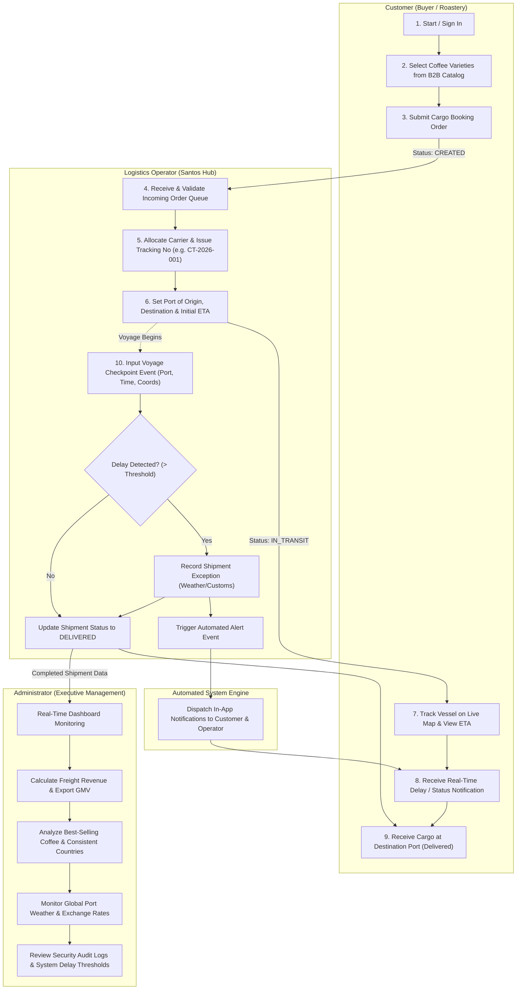

# CargoTrace – Global Shipment Visibility & Tracking Platform

<p align="center">
  
</p>

<p align="center">
  <strong>Enterprise Global Logistics Visibility, B2B Supply Chain Risk Intelligence & Maritime Tracking System</strong><br>
  <em>Final Project (Ujian Akhir Semester - UAS) • Web Programming 2</em>
</p>

<p align="center">
  
  
  
  
  
  
</p>

---

## 📋 Table of Contents
1. [Project Overview & Background](#1-project-overview--background)
2. [Real-World Business Case: Santos Exporters S.A.](#2-real-world-business-case-santos-exporters-sa)
3. [Core System Architecture & Value Chain](#3-core-system-architecture--value-chain)
4. [System Flowmap (Swimlane 5 Stages)](#4-system-flowmap-swimlane-5-stages)
5. [Database Architecture & Entity Relationship Diagram (ERD)](#5-database-architecture--entity-relationship-diagram-erd)
6. [Key Features & Role-Based Access Control (RBAC)](#6-key-features--role-based-access-control-rbac)
7. [Comprehensive Page-by-Page Walkthrough & Screenshots](#7-comprehensive-page-by-page-walkthrough--screenshots)
8. [External Real-Time API Integrations](#8-external-real-time-api-integrations)
9. [REST API Documentation & Postman Collection](#9-rest-api-documentation--postman-collection)
10. [Automated Testing Suite & Security Rules](#10-automated-testing-suite--security-rules)
11. [Local Installation & Setup Guide](#11-local-installation--setup-guide)
12. [Cloud Deployment Guide (Vercel + Supabase)](#12-cloud-deployment-guide-vercel--supabase)
13. [Known Limitations & Future Work](#13-known-limitations--future-work)
14. [Attributions & License](#14-attributions--license)

---

## 1. Project Overview & Background

### Problem Statement
In international freight forwarding and cross-border trade, logistics information is notoriously fragmented across disparate carriers, port terminals, customs brokers, and transport modes. This fragmentation causes several critical operational bottlenecks:
- **Blind Spots for Customers**: B2B buyers lack accurate visibility into current container locations and updated Estimated Time of Arrival (ETA).
- **Uncoordinated Exceptions**: Route bottlenecks such as severe weather, maritime port congestion, and customs clearance holds are rarely detected and communicated in real time.
- **Overwhelmed Logistics Operators**: Dispatchers lack centralized tools to prioritize delayed shipments and take immediate corrective action.
- **Executive Data Deficit**: Business managers lack bird's-eye analytics connecting logistics transit speed with actual export revenue, product demand, and market consistency.

### The CargoTrace Solution
**CargoTrace** is a production-grade **Global Freight Visibility and Risk Intelligence Platform** built as a software portfolio project for the Web Programming 2 Final Examination (*UAS*). Rather than a generic CRUD website, CargoTrace is an end-to-end logistics operating system providing:
1. **Multi-Modal Shipment Lifecycle Management**: Controlled status transitions (`CREATED` $\rightarrow$ `BOOKED` $\rightarrow$ `PICKED_UP` $\rightarrow$ `IN_TRANSIT` $\rightarrow$ `DELIVERED`).
2. **Real-Time Interactive Geolocation Maps**: Powered by **Leaflet.js** and **OpenStreetMap** with custom maritime route polylines and weather overlays.
3. **Automated Delay Severity Calculation**: Rule-based detection classifying delays into `LOW` (0–6h), `MEDIUM` (6–24h), and `HIGH` (>24h) against configurable system thresholds.
4. **Comprehensive Exception Tracking**: Lifecycles for handling `WEATHER_DELAY`, `CUSTOMS_HOLD`, `PORT_CONGESTION`, and documentation issues.
5. **Executive Business Intelligence**: Deep financial turnover metrics, coffee commodity market share, consistent buyer analysis, and carrier SLA compliance.
6. **Multi-Language Localization (i18n)**: Instant dynamic switching between **English (EN)** and **Indonesian (ID)** with a single click.

---

## 2. Real-World Business Case: Santos Exporters S.A.

To demonstrate authentic business engineering, CargoTrace implements the operations of **Santos Exporters S.A.**, based at the **Port of Santos (São Paulo, Brazil)**—the largest maritime container port in Latin America.

- **Primary Industry**: B2B Specialty Green & Roasted Coffee Bean Export.
- **Key Commodities Exported**:
  - *Brazil Santos Yellow Catuai Natural Micro-lot*
  - *Brazil Santos Cerrado Mineiro Single-Origin*
  - *Brazil Santos Strictly Soft Fine Cup (SSFC)*
  - *Brazil Santos Decaf Swiss Water Process*
  - *Kopi Brasil Santos Bourbon Specialty*
  - *Brazil Santos Espresso Roast Master Blend*
- **Global Buyer Destinations**:
  - Specialty roasteries, wholesale importers, and coffee chains across **Japan (Port of Tokyo / Yokohama)**, **Germany (Port of Hamburg)**, **United States (Port of Los Angeles / Long Beach)**, **Italy (Port of Genoa)**, **Australia (Port Botany, Sydney)**, and **Singapore (Port of Singapore)**.
- **Logistics Partners**:
  - Global ocean carriers including **Maersk Line**, **Mediterranean Shipping Company (MSC)**, **CMA CGM**, **Hapag-Lloyd**, and **Ocean Network Express (ONE)**.

---

## 3. Core System Architecture & Value Chain

CargoTrace implements a strict **Service Layer Architecture** separating HTTP presentation, domain business rules, and external persistence:

```
[Browser / Mobile Client / Postman]
               │
               ▼
   [HTTP Routes & Global Middleware]
   ├─ SetLocaleMiddleware (Dynamic EN/ID)
   ├─ Authenticate & Session Guard
   └─ RoleMiddleware (RBAC Authorization)
               │
               ▼
        [Controllers]
   ├─ Admin: Analytics, Shipments, Carriers, Settings
   ├─ Operator: Queue, Dispatch, Tracking, Exceptions
   └─ Customer: Catalog, Orders, Tracking Map
               │
               ▼
       [Domain Service Layer]
   ├─ ShipmentService (Lifecycle & Transitions)
   ├─ TrackingService (Append-only Event Store)
   ├─ EtaService (Deterministic Delay Severity)
   ├─ ExceptionService (Mitigation & Alerts)
   └─ GlobalIntelligenceService (Weather, FX, Macro)
               │
               ▼
    [Eloquent ORM & Integrations]
   ├─ Supabase PostgreSQL / MySQL 8.0+
   └─ External HTTP APIs (Open-Meteo, ExchangeRate, etc.)
```

### The 3 Core Roles (*Value Chain Synergy*):
1. **Customer (Global Buyer / Roastery)**:
   - *Demand Side*: Discovers coffee offerings, submits cargo bookings, tracks container locations in real-time on live maps, and monitors arrival estimates.
2. **Logistics Operator (Santos Hub Dispatcher)**:
   - *Operational Execution*: Validates incoming booking queues, assigns ocean carriers, records append-only voyage checkpoints, updates cargo statuses, and logs operational exceptions.
3. **Administrator (Executive Management)**:
   - *Strategic Governance*: Evaluates macro business health ($6.4M+ commodity GMV, $195K+ freight revenue), top export destinations, carrier on-time rates (88.6% SLA), system configurations, and security audit trails.

---

## 4. System Flowmap (Swimlane 5 Stages)

Below is the end-to-end **5-Stage Process Flowmap** illustrating how data flows between Customer, Operator, Automated Background System, and Administrator:



### Detailed Flow Breakdown:
- **Stage 1 (Order Placement)**: The Customer logs into their portal, browses Santos specialty coffee varieties, specifies cargo weight and destination port, and submits an order. The record is initialized with status `CREATED`.
- **Stage 2 (Validation & Dispatch)**: The Logistics Operator inspects the incoming queue, validates container manifests, assigns a global ocean carrier (e.g., *Maersk*), sets departure/arrival schedules, and issues a tracking number (`CT-2026-XXX`).
- **Stage 3 (In-Transit Tracking)**: As the vessel journeys across international waters, the Operator enters historical checkpoints (*append-only* `tracking_events`). The Customer views the container's live coordinates, distance remaining, and updated ETA on their interactive map.
- **Stage 4 (Delay Detection & Exceptions)**: When a vessel encounters route friction (e.g., tropical storms or customs inspections), the `EtaService` calculates the delay duration. If it exceeds the configurable threshold (default: 6 hours), a `ShipmentException` is generated, and automated in-app alerts are delivered.
- **Stage 5 (Completion & Executive Analytics)**: Upon arrival at the destination port, the shipment is marked `DELIVERED`. The financial turnover, tonnage, commodity value, and SLA performance are automatically fed into the Administrator's **Business Intelligence Dashboard**.

---

## 5. Database Architecture & Entity Relationship Diagram (ERD)

The database is built on **PostgreSQL (Supabase)** and **MySQL 8.0+**, enforcing relational integrity, foreign key constraints, unique indexes, and audit logging.

```mermaid
erDiagram
    users ||--o{ shipments : "customer_orders"
    users ||--o{ tracking_events : "operator_logs"
    users ||--o{ shipment_exceptions : "reported_by"
    users ||--o{ shipment_exceptions : "resolved_by"
    users ||--o{ notifications : "receives"
    users ||--o{ audit_logs : "performed_by"

    carriers ||--o{ shipments : "carries"
    
    locations ||--o{ shipments : "origin_port"
    locations ||--o{ shipments : "destination_port"
    locations ||--o{ shipments : "current_location"
    locations ||--o{ tracking_events : "checkpoint_location"

    shipments ||--o{ shipment_items : "contains_items"
    shipments ||--o{ tracking_events : "audit_timeline"
    shipments ||--o{ shipment_exceptions : "has_exceptions"
    shipments ||--o{ notifications : "triggers_alerts"

    users {
        bigint id PK
        string name
        string email UK
        string password
        enum role "ADMINISTRATOR, LOGISTICS_OPERATOR, CUSTOMER"
        enum status "ACTIVE, INACTIVE"
        string company_name
        string phone
        timestamp last_login_at
        timestamps created_at_updated_at
    }

    carriers {
        bigint id PK
        string code UK
        string name
        string country
        string contact_email
        string contact_phone
        enum status "ACTIVE, INACTIVE"
        timestamps created_at_updated_at
    }

    locations {
        bigint id PK
        string name
        string city
        string country
        enum location_type "PORT, AIRPORT, WAREHOUSE, CUSTOMS_OFFICE"
        decimal latitude
        decimal longitude
        enum status "ACTIVE, INACTIVE"
        timestamps created_at_updated_at
    }

    shipments {
        bigint id PK
        string shipment_number UK
        bigint customer_id FK
        bigint carrier_id FK
        bigint origin_location_id FK
        bigint destination_location_id FK
        bigint current_location_id FK
        string cargo_type
        decimal weight
        decimal volume
        dateTime expected_departure
        dateTime expected_arrival
        dateTime estimated_time_arrival
        enum status "CREATED, BOOKED, PICKED_UP, IN_TRANSIT, DELIVERED"
        int delay_minutes
        enum delay_severity "NONE, LOW, MEDIUM, HIGH"
        timestamps created_at_updated_at
    }

    shipment_items {
        bigint id PK
        bigint shipment_id FK
        string item_name
        string hs_code
        int quantity
        decimal weight
        decimal declared_value
        string currency
        timestamps created_at_updated_at
    }

    tracking_events {
        bigint id PK
        bigint shipment_id FK
        enum event_type "STATUS_CHANGE, CHECKPOINT_REACHED, DEPARTURE, ARRIVAL, CUSTOMS_CLEARED, EXCEPTION_NOTED"
        bigint location_id FK
        string location_name_custom
        decimal latitude
        decimal longitude
        dateTime event_time
        enum shipment_status_at_event
        text description
        bigint created_by FK
        timestamp created_at
    }

    shipment_exceptions {
        bigint id PK
        bigint shipment_id FK
        enum exception_type "CUSTOMS_HOLD, WEATHER_DELAY, PORT_CONGESTION, DAMAGED, MISROUTED, DOCUMENTATION_ISSUE"
        enum severity "LOW, MEDIUM, HIGH, CRITICAL"
        enum status "OPEN, INVESTIGATING, RESOLVED"
        text description
        text resolution_notes
        bigint reported_by FK
        bigint resolved_by FK
        dateTime resolved_at
        timestamps created_at_updated_at
    }

    notifications {
        bigint id PK
        bigint user_id FK
        bigint shipment_id FK
        enum type "DELAY_ALERT, EXCEPTION_ALERT, STATUS_UPDATE, SYSTEM_NOTICE"
        string title
        text message
        enum severity "INFO, WARNING, DANGER, SUCCESS"
        boolean is_read
        dateTime read_at
        timestamps created_at_updated_at
    }

    audit_logs {
        bigint id PK
        bigint user_id FK
        string action
        string entity_type
        string entity_id
        string ip_address
        text user_agent
        json old_values
        json new_values
        text description
        timestamp created_at
    }

    system_settings {
        bigint id PK
        string key UK
        text value
        string group
        string description
        timestamps created_at_updated_at
    }
```



---

## 6. Key Features & Role-Based Access Control (RBAC)

| Feature Module | Customer (Buyer) | Logistics Operator | Administrator Global |
| :--- | :---: | :---: | :---: |
| **B2B Coffee Catalog & Ordering** | Browse & Book New Cargo Orders | View Incoming Order Queue | View Aggregated Commodity Value ($ GMV) |
| **Shipment Management** | View Own Shipments (Anti-IDOR Protected) | Full CRUD & Carrier Dispatching | Full System Oversight & Editing |
| **Live Geolocation Map & ETA** | Interactive Map of Own Shipments | Real-time Fleet Monitoring | Global Logistics Route Oversight |
| **Tracking Event Checkpoints** | Read-Only Historical Stepper | Append-Only Event Creation | Full Audit Trail Inspection |
| **Exception & Incident Handling** | Receive Instant Alert Notices | Log, Investigate & Resolve Issues | Evaluate Exception Impact on Global SLA |
| **Carrier & Location Master Data** | View Assigned Carrier Details | Select Carriers & Hubs | Full CRUD on Global Ports & Carriers |
| **User & Access Management** | Manage Own Profile & Password | Manage Own Profile & Password | Manage All Accounts & Role Assignments |
| **Executive Business Intelligence** | View Own Purchasing Volume | Operational Delay Metrics | 5 Sub-features: Revenue, Demand, SLA, Raw Data |
| **System Settings & Audit Logs** | No Access | No Access | Set Delay Threshold, Timezone, i18n & API Status |

---

## 7. Comprehensive Page-by-Page Walkthrough & Screenshots

### 1. Authentication & Global Localization
- **Login Screen (`/login`)**:
  - Implements a deep space atmospheric UI with glassmorphism container and responsive layouts.
  - Includes **One-Click Demo Fill Badges** for instant evaluation of all three roles:
    - `Administrator`: `admin@cargotrace.id`
    - `Logistics Operator`: `operator@cargotrace.id`
    - `Customer`: `customer@globalmart.com`
  - Features an instant **Language Switcher Pill (`🇬🇧 EN` / `🇮🇩 ID`)** directly on the card header.
- **Registration Screen (`/register`)**:
  - Public onboarding form for prospective coffee buyers and roasteries with company verification.
- **Dynamic Localization Middleware (`app/Http/Middleware/SetLocaleMiddleware.php`)**:
  - Automatically respects user session, quick switcher toggles, or the system default configured in Administrator Settings.

---

### 2. Customer Portal (Self-Service Visibility)
- **Customer Dashboard (`/customer/dashboard`)**:
  - Summarizes active orders, in-transit containers, delivered shipments, and active alerts.
- **B2B Coffee Catalog (`/customer/catalog`)**:
  - Visual catalog of Santos specialty green and roasted coffees with bean altitude, processing method, cupping score, and instant booking modal.
- **My Cargo Orders (`/customer/shipments`)**:
  - Filterable list of all orders submitted by the authenticated customer. Strictly protected by **Anti-IDOR** authorization rules.
- **Live Shipment Tracking Map (`/customer/shipments/{id}/map`)**:
  - Interactive **Leaflet.js** map displaying ocean corridor polylines, origin port, current vessel coordinates, destination port, nautical weather markers, and real-time ETA stepper.
- **Customer Notifications (`/customer/notifications`)**:
  - In-app notification center alerting the buyer of customs clearances, delays, or expected delivery milestones.

---

### 3. Logistics Operator Portal (Hub Dispatch & Control)
- **Operations Dashboard (`/operator/dashboard`)**:
  - Operational metrics focusing on daily dispatch volume, pending bookings, active delays, and open exceptions.
- **Incoming Order Queue (`/operator/queue`)**:
  - Review and validation interface for newly placed customer bookings.
- **Manual Offline B2B Input (`/operator/shipments/create`)**:
  - Rapid dispatch form allowing operators to book direct enterprise contracts, assign ocean carriers, and select global route ports.
- **Shipment Management (`/operator/shipments`)**:
  - Central operational table supporting server-side search, carrier filtering, date range sorting, and pagination.
- **Append-Only Tracking Checkpoint Logger (`/operator/shipments/{id}/tracking`)**:
  - Immutable timeline logging engine ensuring historical event integrity. Once logged, past events cannot be deleted or forged.
- **Shipment Exceptions Management (`/operator/exceptions`)**:
  - Investigation workflow for resolving customs holds, port congestion, and severe maritime storms.
- **Weather & Risk Intelligence (`/operator/intelligence/weather`)**:
  - Real-time meteorological telemetry for global maritime trade corridors powered by the **Open-Meteo Weather API**.

---

### 4. Administrator Portal (Executive Oversight & Governance)
- **Main Executive Dashboard (`/admin/dashboard`)**:
  - 5 High-Level KPI Cards (*Total Shipments, In-Transit, Delivered, Delayed, Open Exceptions*) combined with an interactive global route map and quick-action shortcuts.
- **Business Intelligence & Supply Chain Analytics (`/admin/analytics`)**:
  - Specialized multi-tab executive suite with focused analytics:
    1. **Financials & Revenue**: Freight cash inflows ($195,370+), commodity GMV ($6,471,000+), 100% settlement health, and export tonnage (462.2 Tons).
    2. **Top Coffee Commodities**: Market share breakdown and doughnut charts across all 6 Santos varieties.
    3. **Top Ordering Countries**: Export volume distribution across Japan, Germany, USA, Italy, Australia, Singapore, etc.
    4. **Consistent Roasteries & Buyers**: Repeat purchase volume, average order size, and lifetime partnership ratings.
    5. **SLA & Supply Chain Performance**: Global on-time delivery rate (88.6%), average port-to-port duration (6.3 days), delay ratio (11.4%), and transport mode breakdown.
    6. **Raw Data Table**: Searchable, sortable, export-ready data table with **Print / Export to PDF** capability.
- **Carrier Management (`/admin/carriers`)**:
  - Master data CRUD for global logistics shipping lines (Maersk, MSC, Evergreen, etc.).
- **Location Management (`/admin/locations`)**:
  - Global seaport, airport, and customs hub directory with latitude/longitude coordinates.
- **User Management & RBAC (`/admin/users`)**:
  - Enterprise role assignment and account activation control.
- **System Settings (`/admin/settings`)**:
  - Full-width modern interface configuring system default language (Indonesian/English), timezones (WIB, WITA, WIT, UTC), delay severity threshold (hours), and real-time connectivity status of all 8 external API gateways.
- **Security Audit Logs (`/admin/audit-logs`)**:
  - Complete digital footprint capturing actor ID, action type, IP address, user-agent, previous values, and updated JSON states.

---

## 8. External Real-Time API Integrations

CargoTrace connects to real-time external web services using the **Laravel HTTP Client** with built-in timeouts, intelligent caching, and graceful fallbacks:

| Service / API | External Endpoint | Role in CargoTrace | Cache TTL |
| :--- | :--- | :--- | :---: |
| **Open-Meteo Weather API** | `https://api.open-meteo.com/v1/forecast` | Live marine weather, temperature, wind velocity, precipitation, and storm warnings for maritime hub ports | 15 Min |
| **ExchangeRate-API** | `https://open.er-api.com/v6/latest/{base}` | Live foreign exchange rates (USD, EUR, GBP, IDR, JPY, SGD, BRL) for currency conversion | 30 Min |
| **World Bank Indicator API** | `https://api.worldbank.org/v2/country/{code}/indicator` | Real-time GDP, inflation rates, and demographic indicators for destination countries | 1 Hour |
| **REST Countries API** | `https://restcountries.com/v3.1/alpha/{code}` | Official country profiles, currencies, regional trade blocs, and capital cities | 1 Hour |
| **FreeAirportDB Global API** | `https://api.freeairportdb.com/v1/airports` | Global international cargo airport directory, hub classifications, and runway dimensions | 24 Hours |
| **OpenStreetMap Nominatim** | `https://nominatim.openstreetmap.org/search` | Dynamic geocoding, reverse geocoding, and seaport coordinate lookup | 24 Hours |
| **Leaflet.js + CartoDB Tiles** | `https://{s}.basemaps.cartocdn.com` | High-performance interactive vector tile rendering with Dark/Light theme synchronization | Live Tile |
| **GNews Logistics Stream** | `https://gnews.io/api/v4/search` | International supply chain headline monitoring with lexicon-based sentiment analysis | 30 Min |

---

## 9. REST API Documentation & Postman Collection

CargoTrace provides a complete RESTful API secured by **Laravel Sanctum**. All responses conform to standard JSON schemas and HTTP status codes (`200 OK`, `201 Created`, `401 Unauthorized`, `403 Forbidden`, `404 Not Found`, `422 Unprocessable Entity`).

### Postman Collection
The official Postman Collection file is included in the project repository as `CargoTrace_API_Collection.json`. You can import this file directly into Postman to test all endpoints.

### Core Endpoints Summary:
- **Authentication**:
  - `POST /api/register` – Public customer account registration.
  - `POST /api/login` – Issue Sanctum personal access bearer token.
  - `POST /api/logout` – Revoke current active bearer token.
  - `GET /api/user` – Get authenticated user identity and role.
- **Shipments**:
  - `GET /api/shipments` – Paginated list of shipments (filtered by user role).
  - `POST /api/shipments` – Create new shipment dispatch record.
  - `GET /api/shipments/{id}` – Retrieve complete shipment details & items.
  - `PUT /api/shipments/{id}` – Update shipment manifest or route.
  - `DELETE /api/shipments/{id}` – Soft/hard delete shipment record (Admin only).
- **Tracking Events (Append-Only)**:
  - `GET /api/shipments/{id}/tracking` – Retrieve chronological timeline checkpoints.
  - `POST /api/shipments/{id}/tracking` – Append new voyage event checkpoint.
- **Shipment Exceptions**:
  - `GET /api/shipments/{id}/exceptions` – List issues recorded for a shipment.
  - `POST /api/shipments/{id}/exceptions` – Log new route exception.
  - `PATCH /api/exceptions/{id}` – Resolve or update investigation status.
- **Public Intelligence Endpoints**:
  - `GET /api/countries?code={ISO}` – Macroeconomic indicators from World Bank.
  - `GET /api/currency?base=USD` – Live exchange rate matrix.
  - `GET /api/ports` – Comprehensive maritime port directory.
  - `GET /api/risk` – Weighted supply chain risk formula calculation.

---

## 10. Automated Testing Suite & Security Rules

### Running the Automated Test Suite
CargoTrace is rigorously validated through **39 comprehensive automated feature and unit tests**:

```bash
php artisan test
```

### Security Engineering Standards Implemented:
1. **Anti-IDOR Protection**: Customers attempting to inspect, track, or mutate shipment IDs belonging to another user are strictly rejected with `HTTP 404 Not Found` or `HTTP 403 Forbidden`.
2. **Server-Side Authorization**: Roles are validated via middleware gates at the server level, never relying on frontend button concealment.
3. **Append-Only Timeline Integrity**: Past tracking events cannot be retroactively modified or overwritten.
4. **CSRF & SQL Injection Immunity**: All web forms include `@csrf` token validation, and database operations use Eloquent parameterized bindings.
5. **Secret Isolation**: All credentials, database passwords, and third-party API keys are strictly loaded via `.env` and kept out of version control.

---

## 11. Local Installation & Setup Guide

### System Prerequisites
- **PHP**: `^8.3` or `^8.5` (with extensions: `pdo`, `pdo_mysql`, `pdo_pgsql`, `mbstring`, `openssl`, `curl`, `json`)
- **Composer**: `^2.8`
- **Node.js & npm**: `Node >= 18.x`, `npm >= 9.x`
- **Database**: Local MySQL 8.0+ (Laragon / XAMPP) or Remote Supabase PostgreSQL

### Installation Steps

1. **Clone the Repository**:
   ```bash
   git clone https://github.com/rafifproject/CargoTrace-UAS-Rafif.git
   cd CargoTrace
   ```

2. **Install PHP & Node Dependencies**:
   ```bash
   composer install
   npm install
   ```

3. **Configure Environment File**:
   ```bash
   cp .env.example .env
   php artisan key:generate
   ```

4. **Configure Database Connection**:
   - For **Local MySQL (Laragon/XAMPP)**:
     ```ini
     DB_CONNECTION=mysql
     DB_HOST=127.0.0.1
     DB_PORT=3306
     DB_DATABASE=cargotrace
     DB_USERNAME=root
     DB_PASSWORD=
     ```
   - For **Supabase Cloud PostgreSQL**:
     ```ini
     DB_CONNECTION=pgsql
     DB_HOST=aws-0-ap-southeast-1.pooler.supabase.com
     DB_PORT=5432
     DB_DATABASE=postgres
     DB_USERNAME=postgres.your_project_id
     DB_PASSWORD=your_supabase_db_password
     DB_SSLMODE=require
     ```

5. **Run Migrations & Database Seeders**:
   ```bash
   php artisan migrate:fresh --seed
   ```
   *The seeder populates 40+ international seaports, 9 shipping lines, 15+ multi-container shipments, append-only tracking events, and accounts for all 3 roles.*

6. **Build Frontend Assets**:
   ```bash
   npm run build
   ```

7. **Start the Local Development Server**:
   ```bash
   php artisan serve
   ```
   Access the platform in your browser at: **`http://localhost:8000`**

---

## 12. Cloud Deployment Guide (Vercel + Supabase)

CargoTrace is architected to run seamlessly on modern serverless cloud infrastructure:
- **Application & Frontend Runtime**: **Vercel** (via PHP Serverless Runtime).
- **Relational Database**: **Supabase** (Managed PostgreSQL Serverless).

### Step 1: Configure Supabase Database
1. Create a new project in your [Supabase Dashboard](https://supabase.com).
2. Go to **Project Settings** $\rightarrow$ **Database** and copy your **Connection String (Transaction Pooler or Direct Connection)**.
3. Obtain your database host, port, username, password, and database name (`postgres`).

### Step 2: Configure Vercel Deployment
Create a `vercel.json` file in your project root:

```json
{
  "version": 2,
  "framework": null,
  "functions": {
    "api/index.php": {
      "runtime": "vercel-php@0.7.1"
    }
  },
  "routes": [
    {
      "src": "/build/(.*)",
      "dest": "/public/build/$1"
    },
    {
      "src": "/(favicon.ico|favicon.svg|favicon.png|apple-touch-icon.png|robots.txt)",
      "dest": "/public/$1"
    },
    {
      "src": "/(.*)",
      "dest": "/api/index.php"
    }
  ],
  "env": {
    "APP_ENV": "production",
    "APP_DEBUG": "false",
    "APP_CONFIG_CACHE": "/tmp/config.php",
    "APP_EVENTS_CACHE": "/tmp/events.php",
    "APP_PACKAGES_CACHE": "/tmp/packages.php",
    "APP_ROUTES_CACHE": "/tmp/routes.php",
    "APP_SERVICES_CACHE": "/tmp/services.php",
    "VIEW_COMPILED_PATH": "/tmp",
    "CACHE_STORE": "array",
    "SESSION_DRIVER": "cookie",
    "LOG_CHANNEL": "stderr"
  }
}
```

Create `api/index.php` as the serverless bridge:
```php
<?php
require __DIR__ . '/../public/index.php';
```

### Step 3: Set Environment Variables in Vercel
In the Vercel Dashboard under **Project Settings** $\rightarrow$ **Environment Variables**, configure:
```ini
APP_NAME=CargoTrace
APP_ENV=production
APP_KEY=base64:your_generated_app_key
APP_DEBUG=false
APP_URL=https://your-cargotrace.vercel.app

DB_CONNECTION=pgsql
DB_HOST=aws-0-ap-southeast-1.pooler.supabase.com
DB_PORT=5432
DB_DATABASE=postgres
DB_USERNAME=postgres.your_supabase_ref
DB_PASSWORD=your_supabase_password
DB_SSLMODE=require

SESSION_DRIVER=cookie
CACHE_STORE=array
LOG_CHANNEL=stderr
```

Deploy by pushing your repository to GitHub and connecting it to Vercel. Run database migrations on Supabase by connecting via your local CLI:
```bash
php artisan migrate --force
php artisan db:seed --force
```

---

## 13. Known Limitations & Future Work

In compliance with the academic project scope defined in the UAS brief:
- **Synthetic Geolocation Coordinates**: Vessel positions along high-seas voyage corridors utilize simulated coordinates based on actual maritime shipping lanes rather than physical satellite AIS transponders.
- **Commercial Payment Gateway**: Financial settlements and freight invoicing are simulated with payment health tracking rather than live banking payment gateways.
- **Future Work**:
  - Integration with hardware IoT temperature and humidity sensors for green coffee beans in refrigerated containers (*reefer containers*).
  - Webhook integration with real commercial shipping APIs (e.g., Maersk or Hapag-Lloyd Developer Portals).
  - Automated WhatsApp / SMS dispatch alerts using Twilio or message brokers.

---

## 14. Attributions & License

- **Framework**: [Laravel](https://laravel.com) by Taylor Otwell and contributors (MIT License).
- **Styling**: [Tailwind CSS](https://tailwindcss.com) by Tailwind Labs (MIT License).
- **Mapping**: [Leaflet.js](https://leafletjs.com) by Volodymyr Agafonkin and [OpenStreetMap](https://www.openstreetmap.org) contributors (ODbL).
- **Map Vector Tiles**: [CartoDB Basemaps](https://carto.com/basemaps) (CC BY 3.0).
- **Iconography**: [Lucide Icons](https://lucide.dev) (ISC License).
- **Charts**: [Chart.js](https://www.chartjs.org) (MIT License).
- **Weather Telemetry**: [Open-Meteo](https://open-meteo.com) (Non-Commercial Open Data License).
- **Currencies**: [ExchangeRate-API](https://www.exchangerate-api.com).
- **Development**: Developed by **Rafif** for the Final Examination (*Ujian Akhir Semester - UAS*) of the **Web Programming 2** course.

---

<p align="center">
  <strong>CargoTrace &bull; Built with engineering precision.</strong>
</p>
