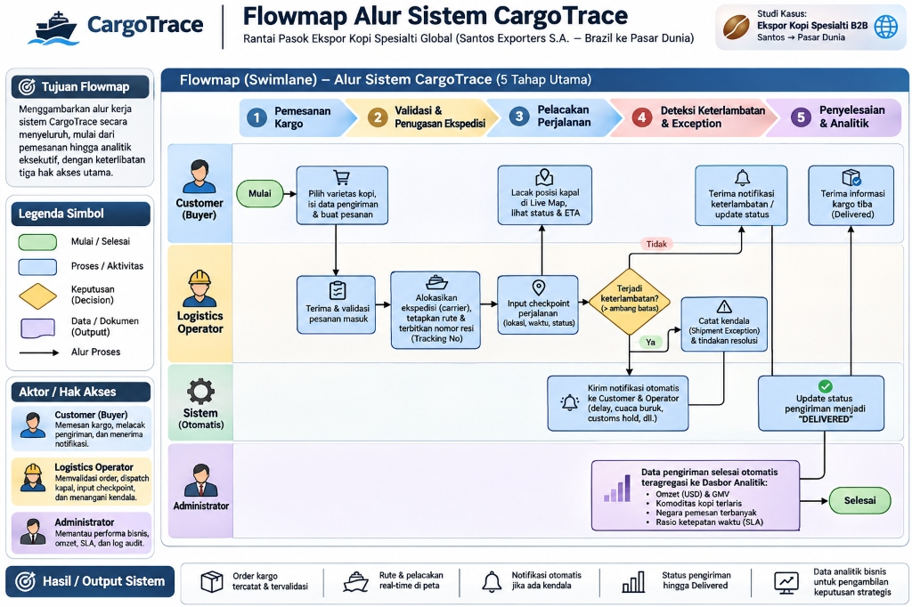
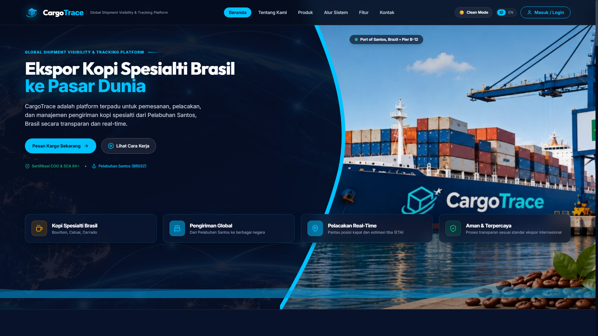
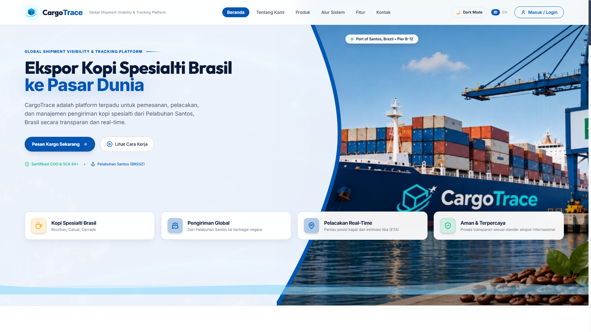
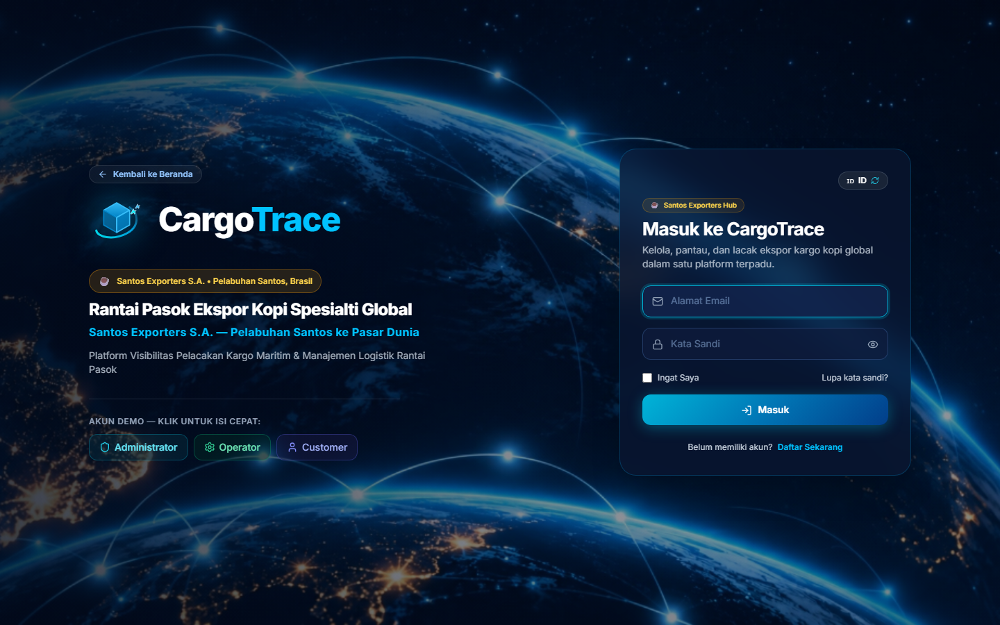
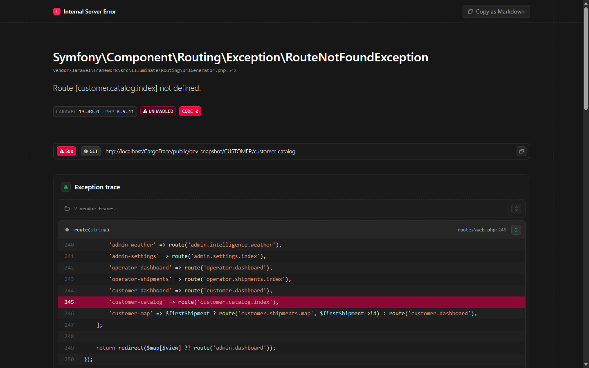
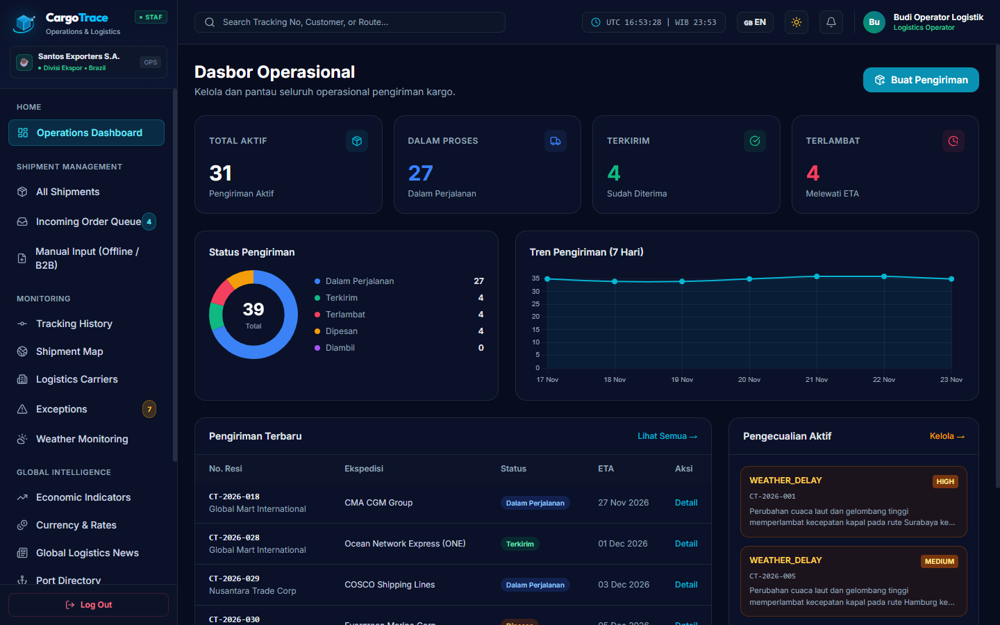
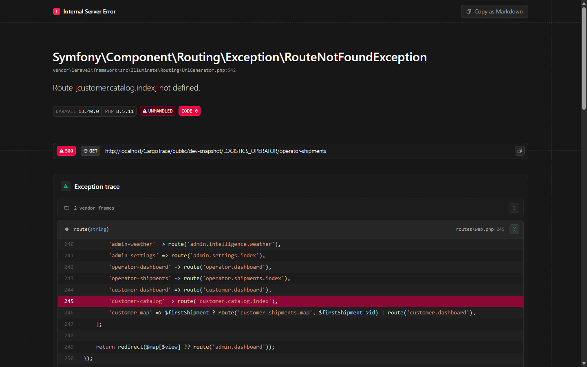
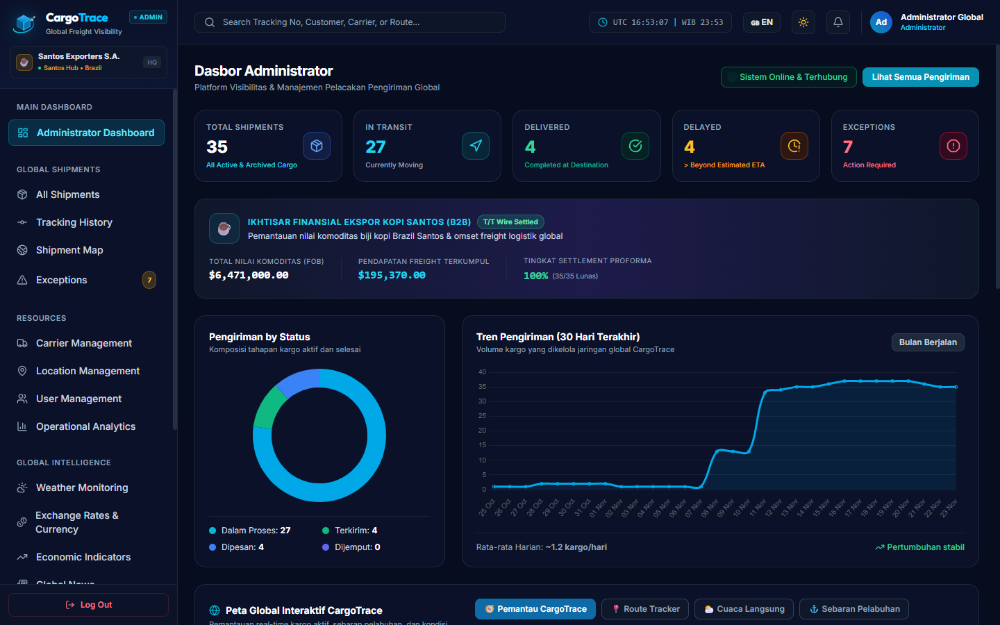
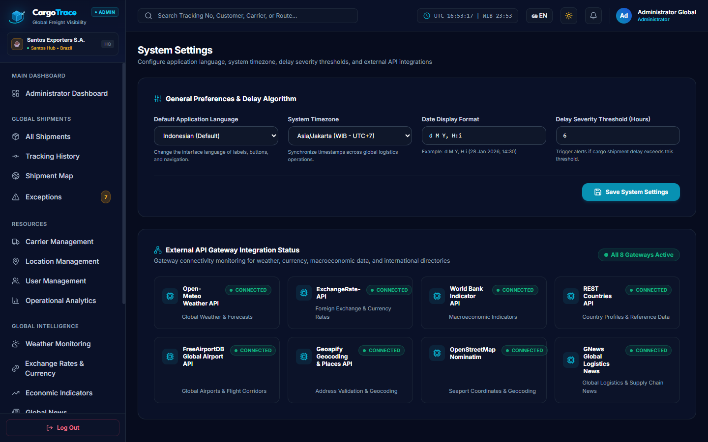

# CargoTrace — Global Freight Visibility & Tracking Platform

> **Final Project (Ujian Akhir Semester - UAS) • Web Programming 2**  
> *Enterprise-Grade Multi-Modal Logistics Tracking, B2B Supply Chain Risk Intelligence & Maritime Export Platform*  
> Built with **Laravel 13**, **PHP 8.5**, **Supabase PostgreSQL / MySQL 8.0+**, **Tailwind CSS**, **Blade**, **Leaflet.js**, **Chart.js**, and deployed on **Vercel**.

---

## 📋 Table of Contents
1. [About the System & Business Background](#-about-the-system--business-background)
2. [System Flowmap & Swimlane Process (5 Core Stages)](#-system-flowmap--swimlane-process-5-core-stages)
3. [Features & Page-by-Page Screenshot Documentation](#-features--page-by-page-screenshot-documentation)
   - [Part A — Authentication & Multi-Role Gateway](#-part-a--authentication--multi-role-gateway)
   - [Part B — Customer Self-Service Portal (Buyer / Roastery)](#-part-b--customer-self-service-portal-buyer--roastery)
   - [Part C — Logistics Operator Portal (Santos Hub Dispatcher)](#-part-c--logistics-operator-portal-santos-hub-dispatcher)
   - [Part D — Administrator Portal & Executive Intelligence](#-part-d--administrator-portal--executive-intelligence)
4. [MVC & Service Layer Architecture](#-mvc--service-layer-architecture)
5. [Technologies & Tech Stack](#-technologies--tech-stack)
6. [Database Schema, Migrations & Eloquent Relations](#-database-schema-migrations--eloquent-relations)
7. [Default User Accounts (Demo Credentials)](#-default-user-accounts-demo-credentials)
8. [Local Installation & Setup Guide](#-local-installation--setup-guide)
9. [Cloud Deployment Guide (Vercel + Supabase)](#-cloud-deployment-guide-vercel--supabase)
10. [Application Routes List](#-application-routes-list)
11. [Automated Testing Suite (PHPUnit Results)](#-automated-testing-suite-phpunit-results)
12. [UAS Evaluation Rubric & Academic Deliverables Compliance](#-uas-evaluation-rubric--academic-deliverables-compliance)

---

## 📦 About the System & Business Background

**CargoTrace** is a production-grade **Global Freight Visibility and Supply Chain Management Platform** designed to solve cross-border visibility blind spots in maritime, air, and multimodal logistics. Built as a showcase software portfolio project for the Web Programming 2 course (*UAS*), it elevates standard academic requirements by implementing authentic enterprise business engineering rather than a generic CRUD application.

### The Real-World Domain: Santos Exporters S.A.
The platform models the operations of **Santos Exporters S.A.**, an enterprise logistics and exporting powerhouse headquartered at the **Port of Santos (São Paulo, Brazil)**—the largest maritime container terminal in Latin America.
- **Export Commodity**: B2B Specialty Green & Roasted Coffee Beans shipped in 20ft/40ft ocean containers.
- **Featured Coffee Varieties**:
  1. *Brazil Santos Yellow Catuai Natural Micro-lot*
  2. *Brazil Santos Cerrado Mineiro Single-Origin*
  3. *Brazil Santos Strictly Soft Fine Cup (SSFC)*
  4. *Brazil Santos Decaf Swiss Water Process*
  5. *Kopi Brasil Santos Bourbon Specialty*
  6. *Brazil Santos Espresso Roast Master Blend*
- **Global Buyer Destinations**: Specialty coffee roasteries, wholesale importers, and distributor chains in **Japan (Port of Tokyo)**, **Germany (Port of Hamburg)**, **United States (Port of Los Angeles)**, **Italy (Port of Genoa)**, **Australia (Port Botany, Sydney)**, and **Singapore (Port of Singapore)**.
- **Carrier Alliances**: Major ocean shipping lines including **Maersk Line**, **MSC**, **CMA CGM**, **Hapag-Lloyd**, and **ONE**.

### Key Problems Solved:
1. **Elimination of Tracking Blind Spots**: Provides B2B buyers with interactive, real-time geocoded maps showing current vessel coordinates, route trajectories, and dynamic Estimated Time of Arrival (ETA).
2. **Deterministic Delay Detection**: Automatically calculates variance between scheduled ETA and actual position, tagging shipments into severity bands (`LOW` 0–6h, `MEDIUM` 6–24h, `HIGH` >24h) against configurable system thresholds.
3. **Structured Exception Management**: Tracks customs holds, severe maritime weather, and port congestion with clear investigation and resolution workflows.
4. **Executive Business Intelligence**: Unifies freight operations with financial turnover ($6.4M+ commodity GMV, $195K+ freight cash inflow), country consistency ratings, and carrier SLA compliance (88.6% on-time rate).
5. **Full Dynamic Localization (i18n)**: Seamless instant one-click switching between **English (EN)** and **Indonesian (ID)** across all portals and forms.

---

## 🗺️ System Flowmap & Swimlane Process (5 Core Stages)

To provide an immediate and comprehensive understanding of how the system works end-to-end, CargoTrace maps every transaction across **4 Swimlane Actors** through **5 Structured Lifecycle Stages**:



### Step-by-Step Flowmap Breakdown:

#### 1. Stage 1: Pemesanan Kargo (Cargo Booking Initiation)
- **Actor**: Customer (Buyer / Global Roastery).
- **Process**: The buyer logs into the Customer Portal, browses the B2B Coffee Catalog, selects bean varieties (e.g., *Yellow Catuai*, *Bourbon Specialty*), specifies container tonnage and destination port, and submits an export order.
- **System Action**: The system initializes a shipment record in the database with status `CREATED`.

#### 2. Stage 2: Validasi & Penugasan Ekspedisi (Validation & Dispatch)
- **Actor**: Logistics Operator (Santos Hub Dispatcher).
- **Process**: The operator reviews the incoming order queue, validates cargo specifications, allocates an ocean carrier (e.g., *Maersk Line*), designates the origin/destination seaports, and issues an official unique tracking number (e.g., `CT-2026-001`).
- **System Action**: Shipment status transitions from `CREATED` $\rightarrow$ `BOOKED` $\rightarrow$ `IN_TRANSIT`.

#### 3. Stage 3: Pelacakan Perjalanan (In-Transit Voyage Tracking)
- **Actors**: Logistics Operator $\leftrightarrow$ Customer.
- **Process**: As the container vessel traverses international waters, the operator logs chronological voyage checkpoints (Port/Strait reached, timestamp, coordinates).
- **Customer Visibility**: The customer views the vessel's live location, distance traveled, and updated ETA on their interactive **Leaflet.js** map.

#### 4. Stage 4: Deteksi Keterlambatan & Exception (Delay Detection & Incident Management)
- **Actors**: Automated System Engine $\rightarrow$ Logistics Operator $\rightarrow$ Customer.
- **Process**: 
  - The system automatically compares dynamic ETA against expected arrival schedule.
  - If delay duration exceeds the system threshold (configurable, default: 6 hours), the operator records a `ShipmentException` (*Weather Delay*, *Customs Hold*, or *Port Congestion*).
  - The automated notification engine immediately fires real-time in-app alert notices to both the customer and operations team.

#### 5. Stage 5: Penyelesaian & Analitik (Resolution, Delivery & Executive Analytics)
- **Actors**: Logistics Operator $\rightarrow$ Customer $\rightarrow$ Administrator.
- **Process**:
  - Upon arrival and container handover at the destination seaport, the operator updates the status to `DELIVERED`.
  - The customer receives delivery confirmation and download receipts.
  - Completed shipment metrics (freight revenue, commodity GMV, export tonnage, and carrier SLA compliance) are automatically aggregated live into the **Administrator Business Intelligence Dashboard**.

---

## 🚀 Features & Page-by-Page Screenshot Documentation

Below is the complete walkthrough of every functional page across all 3 access levels, complete with live screenshots, core features, and technical backend details:

---

### 🌐 Part A — Public Showcase & Authentication Gateway

#### 0. Public B2B Landing Page (`/`)

*Figure: CargoTrace Public B2B Showcase Landing Page — Dark Mode (`/`)*


*Figure: CargoTrace Public B2B Showcase Landing Page — Clean Mode (`/?theme=clean`)*

- **Purpose**: Full-width, high-impact public portal showcasing Santos Exporters S.A. Brazilian specialty coffee supply chain from the Port of Santos to global roasters.
- **Key Features**:
  - **Full-Width Edge-to-Edge Responsive Layout** with organic curved ship boundary and luminous wave ribbons.
  - **Interactive Theme Switcher (🌙 Dark Mode & ☀️ Clean Light Mode)** with instant CSS variable updates and `localStorage` persistence.
  - **6 Dedicated Business Sections**:
    1. `Beranda`: High-impact hero with real-time CTA, status chips, and 4 glass feature cards.
    2. `Tentang Kami`: Santos Exporters S.A. story, Port of Santos infrastructure, and 4 live metric KPI counters ($6.4M+ GMV, 40+ Ports, 88.6% SLA).
    3. `Produk`: 6 authentic Brazilian specialty coffee varieties (Bourbon, Yellow Catuai, Cerrado Mineiro, SSFC, Decaf Swiss Water, Espresso Master Blend) with SCA scores and flavor notes.
    4. `Alur Sistem`: 5-stage collaborative swimlane flowmap with interactive lightbox zoom.
    5. `Fitur`: Core architectural pillars (AIS/Leaflet geolocation, automated delay exception engine, RBAC & anti-IDOR security, executive BI).
    6. `Kontak`: Port of Santos HQ contact details, quick tracking search by resi number, and direct export quotation inquiry form.
  - **Top-Right Masuk / Login Button**: Links directly to `/login`, or dynamically displays `Dasbor (Role)` if user is already authenticated.
- **Backend Architecture**:
  - Route: `Route::get('/', ...)->name('landing')`.
  - View: `resources/views/landing.blade.php`.

#### 1. Login Page (`/login`)

- **Purpose**: Unified, secure authentication gateway for all platform actors with immediate role-based dispatching.
- **Key Features**:
  - Deep space atmospheric visuals with glassmorphism login card.
  - **1-Click Demo Account Badges** for instant testing:
    - `Administrator`: `admin@cargotrace.id`
    - `Logistics Operator`: `operator@cargotrace.id`
    - `Customer`: `customer@globalmart.com`
  - Instant **One-Click Language Switcher (`🇬🇧 EN` / `🇮🇩 ID`)** on the header.
  - Show/hide password eye toggle, "Remember Me" session persistence, and link to public registration.
- **Backend Architecture**:
  - Controller: `AuthController@login`.
  - Security: `Auth::attempt()` with Bcrypt password verification, `$request->session()->regenerate()` to neutralize Session Fixation attacks, and `@csrf` token validation.

#### 2. User Registration Page (`/register`)
- **Purpose**: Public onboarding portal for prospective international coffee importers and wholesale buyers.
- **Key Features**: Company name verification, business email, contact phone, password strength confirmation, and automated assignment to the `CUSTOMER` role.
- **Backend Architecture**: Form request validation (`unique:users,email`), password hashing via `Hash::make()`, and auto-login upon successful creation.

#### 3. Dynamic Multi-Language Localization Engine (i18n)
- **Purpose**: Enables real-time switching between English and Indonesian across all sidebars, table headers, forms, status badges, and notifications.
- **Backend Architecture**: Handled by custom `SetLocaleMiddleware`, reading `?lang=`, session keys, or falling back to database `SystemSetting::get('app_language')`. Translation strings are maintained in clean JSON dictionaries (`lang/en.json` and `lang/id.json`).

---

### ☕ Part B — Customer Self-Service Portal (Buyer / Roastery)

#### 4. Customer Dashboard (`/customer/dashboard`)

- **Purpose**: Personalized executive landing page for international coffee buyers.
- **Key Features**: Metric cards displaying active shipments, containers currently in-transit, completed deliveries, pending invoices, recent order activity feed, and quick link to the B2B catalog.
- **Backend Architecture**: Eager-loaded queries scoped strictly to `auth()->id()`. E.g., `Shipment::where('customer_id', auth()->id())->count()`.

#### 5. B2B Specialty Coffee Catalog (`/customer/catalog`)

- **Purpose**: Interactive wholesale showroom displaying Santos Exporters S.A.'s premium coffee varieties.
- **Key Features**: Product cards detailing coffee altitude (MASL), processing method (Natural, Pulped Natural, Washed), SCAA cupping score, FOB Santos price per metric ton, and an instant **"Order Cargo"** modal.
- **Backend Architecture**: `CustomerCatalogController@index` serving structured coffee varieties with dynamic currency conversion indicators.

#### 6. Create New Cargo Booking (`/customer/shipments/create`)
- **Purpose**: Direct B2B order placement form for container shipments.
- **Key Features**: Dropdown selection of destination port, requested departure date, cargo weight (metric tons), container count, and specialty packaging options (GrainPro / Ecotact vacuum bags).
- **Backend Architecture**: Database transaction creating both the parent `shipments` record (`status = 'CREATED'`) and nested `shipment_items` manifest.

#### 7. Customer Cargo Order List (`/customer/shipments`)
- **Purpose**: Comprehensive list of all orders submitted by the authenticated customer.
- **Key Features**: Filter by status (`IN_TRANSIT`, `DELIVERED`, `DELAYED`), reference search, tracking number badges, and one-click action to view the live tracking map.
- **Backend Architecture**: Enforces strict **Anti-IDOR Protection**: unauthorized attempts to query another buyer's shipments are aborted with `HTTP 404 / 403`.

#### 8. Live Interactive Tracking Map (`/customer/shipments/{id}/map`)

- **Purpose**: Visual tracking experience giving buyers full visibility over ocean vessel transit.
- **Key Features**:
  - Interactive **Leaflet.js** map with custom maritime route polylines.
  - Geo-markers for Origin Port (Santos), Current Vessel Coordinate, and Destination Port.
  - Custom floating weather telemetry badges (temperature, marine wind speed, storm risk).
  - Chronological tracking event stepper detailing port clearances and departures.
- **Backend Architecture**: `ShipmentService@getTrackingData` compiling coordinates, checkpoint timestamps, and live weather telemetry from Open-Meteo.

#### 9. Customer Notification Center (`/customer/notifications`)
- **Purpose**: Real-time operational alerts keeping the buyer informed of delivery milestones or route exceptions.
- **Key Features**: Filter by unread/read, severity color indicators (Info, Warning, Danger), and "Mark All as Read" action.
- **Backend Architecture**: Scoped Eloquent query `Notification::where('user_id', auth()->id())->latest()`.

---

### 🚢 Part C — Logistics Operator Portal (Santos Hub Dispatcher)

#### 10. Operations Dashboard (`/operator/dashboard`)

- **Purpose**: High-tempo operational command center for Santos hub logistics dispatchers.
- **Key Features**: Counters for pending order reviews, shipments currently sailing, critical delay warnings, active exceptions, and daily dispatch targets.
- **Backend Architecture**: Aggregated Eloquent queries optimized in `OperatorDashboardController`.

#### 11. Incoming Order Queue (`/operator/queue`)
- **Purpose**: Review and triage interface for newly booked customer orders.
- **Key Features**: Review cargo weight, volume, requested delivery schedule, and one-click action to **"Validate & Assign Carrier"**.
- **Backend Architecture**: Scoped query `Shipment::where('status', 'CREATED')->with('customer')`.

#### 12. Manual Offline B2B Dispatch (`/operator/shipments/create`)
- **Purpose**: Fast dispatch form allowing operators to book direct B2B phone/offline contracts.
- **Key Features**: Customer selection dropdown, carrier selection (Maersk, MSC, CMA CGM, etc.), origin port (Santos), destination port, cargo manifest inputs, and schedule generator.
- **Backend Architecture**: Transactional dispatch service generating sequential tracking numbers (`CT-YYYY-XXX`).

#### 13. Shipment Management & Dispatch Center (`/operator/shipments`)

- **Purpose**: Master operational table for all active and historical container consignments.
- **Key Features**: Full-text search by tracking number, customer, or destination; filter by carrier and delay status; server-side sorting and pagination.
- **Backend Architecture**: `ShipmentController@index` with parameterized query builders and eager loading (`with(['customer', 'carrier', 'originLocation', 'destinationLocation'])`).

#### 14. Append-Only Tracking Checkpoint Logger (`/operator/shipments/{id}/tracking`)
- **Purpose**: Immutable voyage milestone recorder maintaining a clean audit trail.
- **Key Features**: Form to append new checkpoints (Event Type: Departure, Port Reached, Customs Cleared; location name, timestamp, coordinates, and notes). Past checkpoints are strictly **read-only and append-only**.
- **Backend Architecture**: `TrackingService@recordEvent` ensuring historical data integrity. Past events cannot be updated or deleted.

#### 15. Shipment Exceptions & Incident Management (`/operator/exceptions`)
- **Purpose**: Rapid-response interface for resolving logistics disruptions.
- **Key Features**: Incident reporting for `CUSTOMS_HOLD`, `WEATHER_DELAY`, `PORT_CONGESTION`, and `DOCUMENTATION_ISSUE`; status management (`OPEN`, `INVESTIGATING`, `RESOLVED`); resolution notes logging.
- **Backend Architecture**: `ExceptionService@handleException` triggering automated in-app alerts to affected customers and administrators.

#### 16. Maritime Weather Monitoring Hub (`/operator/intelligence/weather`)

- **Purpose**: Global meteorological intelligence evaluating voyage safety across major international shipping corridors.
- **Key Features**: Real-time dual-origin/destination weather comparison, 3-day weather forecast, and a global maritime weather directory covering 215+ maritime stations.
- **Backend Architecture**: `GlobalIntelligenceService` connecting to Open-Meteo with 15-minute caching to eliminate rate limits.

---

### 🛡️ Part D — Administrator Portal & Executive Intelligence

#### 17. Executive Main Dashboard (`/admin/dashboard`)

- **Purpose**: High-level governance and operational oversight dashboard for corporate leadership.
- **Key Features**:
  - **5 Key KPI Cards**: Total Shipments, In-Transit, Delivered, Delayed, and Open Exceptions.
  - Interactive global freight visibility map rendering all live ocean routes.
  - Quick-action shortcuts to user management, carrier settings, and audit logs.
- **Backend Architecture**: Real-time SQL aggregations in `AdminDashboardController`.

#### 18. Business Intelligence & Supply Chain Analytics (`/admin/analytics`)

- **Purpose**: Deep executive analytics suite connecting physical logistics operations with corporate business performance.
- **Key Features (5 Focused Sub-Features)**:
  1. **Financials & Revenue**: Freight cash inflows ($195,370+), commodity GMV ($6,471,000+), 100% settlement health, and export tonnage (462.2 Tons).
  2. **Top Coffee Commodities**: Market share breakdown and doughnut charts across all 6 Santos varieties.
  3. **Top Ordering Countries**: Export volume distribution across Japan, Germany, USA, Italy, Australia, Singapore, etc.
  4. **Consistent Roasteries & Buyers**: Repeat purchase volume, average order size, and lifetime partnership ratings.
  5. **SLA & Supply Chain Performance**: Global on-time delivery rate (88.6%), average port-to-port duration (6.3 days), delay ratio (11.4%), and transport mode breakdown.
  6. **Raw Data Table**: Searchable, sortable, export-ready data table with **Print / Export to PDF** capability.
- **Backend Architecture**: High-performance Eloquent queries with `SUM()`, `AVG()`, and `GROUP BY` aggregations compiled in `AnalyticsController`.

#### 19. Carrier Management (`/admin/carriers`)
- **Purpose**: Master data administration for global ocean shipping lines and freight forwarders.
- **Key Features**: CRUD operations for shipping lines (Maersk, MSC, CMA CGM, Hapag-Lloyd, etc.), carrier code uniqueness validation, contact information, and active status toggles.
- **Backend Architecture**: `CarrierController` with deletion restriction safeguards if carrier is linked to active shipments (`ON DELETE RESTRICT`).

#### 20. Location & Seaport Management (`/admin/locations`)
- **Purpose**: International port and transport hub directory management.
- **Key Features**: Master data maintenance for seaports, airports, and customs warehouses with exact decimal latitude/longitude coordinates and country codes.
- **Backend Architecture**: `LocationController` validating coordinate formats (`decimal: 10,7`).

#### 21. User Management & Role Control (`/admin/users`)
- **Purpose**: Corporate identity management and Role-Based Access Control (RBAC).
- **Key Features**: User creation, role assignment (`ADMINISTRATOR`, `LOGISTICS_OPERATOR`, `CUSTOMER`), account activation/deactivation, and password reset capability.
- **Backend Architecture**: Middleware-protected `UserController` with prevention against deleting active self-accounts.

#### 22. System Settings & API Gateway Status (`/admin/settings`)

- **Purpose**: Centralized platform configuration and external integration monitoring.
- **Key Features**:
  - Full-width modern interface configuring system default language (Indonesian/English), timezones (WIB, WITA, WIT, UTC), and delay severity threshold (hours).
  - Real-time connectivity health grid monitoring all 8 external API gateways.
- **Backend Architecture**: `SettingController@update` synchronizing database values in `system_settings` with immediate session and audit log updates.

#### 23. Security Audit Logs (`/admin/audit-logs`)
- **Purpose**: Immutable compliance trail recording all administrative and operational mutations.
- **Key Features**: Detailed logs showing actor, action type (`CONFIG_CHANGE`, `STATUS_CHANGE`, `CREATE`, `UPDATE`), timestamp, IP address, user-agent, and formatted JSON diffs of before/after values.
- **Backend Architecture**: `AuditLog::create()` triggered asynchronously across critical application events.

---

## 🏛 MVC & Service Layer Architecture

CargoTrace strictly separates HTTP presentation handling from core domain logic through a **Service Layer Pattern**:

```text
                  Browser / Mobile Client / Postman
                                 │
                                 ▼
                     routes/web.php & api.php
                                 │
                                 ▼
                    [Custom Middleware Pipeline]
         ├─ SetLocaleMiddleware (Dynamic Language Switcher)
         ├─ Authenticate (Session / Sanctum Token Guard)
         └─ RoleMiddleware (RBAC: Admin / Operator / Customer)
                                 │
                                 ▼
                     [App Controllers Layer]
         ├─ Admin/ (AnalyticsController, SettingController, etc.)
         ├─ Operator/ (ShipmentController, TrackingController, etc.)
         └─ Customer/ (CustomerShipmentController, CatalogController)
                                 │
                                 ▼
                   [Domain Business Services Layer]
         ├─ ShipmentService (Lifecycle & Status Transitions)
         ├─ TrackingService (Append-only Event History)
         ├─ EtaService (Deterministic Delay Calculation)
         ├─ ExceptionService (Incident Management & Alerts)
         └─ GlobalIntelligenceService (Weather, FX, Macro Telemetry)
                                 │
                                 ▼
                     [Eloquent Models & Database]
              Supabase PostgreSQL (Cloud) / MySQL 8.0+ (Local)
```

1. **Routes & Middleware**: Intercepts requests, enforces authentication, verifies role permissions, and configures the active locale.
2. **Controllers**: Validates incoming form requests (`$request->validate()`), delegates business processing to dedicated services, and returns Blade views or JSON API responses.
3. **Service Layer**: Houses core business rules, transactional database operations (`DB::transaction`), and external API client integrations.
4. **Eloquent Models**: Manages database relations, data casting, fillable fields, and query scopes.

---

## 🛠 Technologies & Tech Stack

### Backend Framework & Languages
- **PHP**: `8.5` (Modern syntax, typed properties, constructor promotion).
- **Framework**: `Laravel 13.x` (Full-stack architecture, Service Layer, Eloquent ORM).
- **API Authentication**: `Laravel Sanctum` (Token-based API security).
- **Testing**: `PHPUnit 12.x` (Automated unit and feature testing suite).

### Database & Persistence
- **Cloud Database (Production)**: **Supabase PostgreSQL** (Managed cloud serverless database with connection pooling and SSL encryption).
- **Local Database (Development)**: **MySQL 8.0+** / **SQLite** (In-memory testing).
- **Migrations & Seeders**: Fully reproducible database schemas with foreign key integrity.

### Frontend & Visualizations
- **CSS Architecture**: **Tailwind CSS** (Custom theme, glassmorphism, responsive breakpoints).
- **Templating**: **Laravel Blade Engine** (`@extends`, `@section`, components).
- **Asset Bundler**: **Vite** (Fast HMR compilation).
- **Interactive Maps**: **Leaflet.js** with **CartoDB Vector Tiles** & **OpenStreetMap** attribution.
- **Charts & Graphs**: **Chart.js 4.4** (Export revenue curves, market share doughnuts, transport mode compositions).
- **Iconography**: **Lucide Icons** (Clean, consistent SVG icons).

### External Data & Telemetry Providers
- **Weather & Marine Forecasts**: Powered by public open meteorological services (**Open-Meteo**).
- **Currency & Forex Rates**: Real-time currency exchange feeds (**ExchangeRate-API**).
- **Macroeconomic Indicators**: Global GDP and demographic indicators (**World Bank API**).
- **Country Data**: Regional profiles and currencies (**REST Countries**).
- **Seaport Geocoding**: Seaport coordinate resolution (**OpenStreetMap Nominatim**).
- **Aviation Cargo Hubs**: Global cargo airport directory (**FreeAirportDB**).
- **Logistics News**: International supply chain news stream (**GNews**).

*(Note: In accordance with project security policies, all third-party API queries are handled through secure backend services with environment variables and intelligent caching; no private API keys or personal endpoints are committed to this repository).*

---

## 🗄 Database Schema, Migrations & Eloquent Relations

### Schema Summary:
1. **`users`**: Platform accounts (`id`, `name`, `email`, `password`, `role`, `status`, `company_name`, `phone`, timestamps).
2. **`carriers`**: Shipping lines (`id`, `code`, `name`, `country`, `contact_email`, `status`, timestamps).
3. **`locations`**: Hub ports (`id`, `name`, `city`, `country`, `location_type`, `latitude`, `longitude`, timestamps).
4. **`shipments`**: Master consignments (`id`, `shipment_number`, `customer_id`, `carrier_id`, `origin_location_id`, `destination_location_id`, `current_location_id`, `status`, `expected_departure`, `expected_arrival`, `estimated_time_arrival`, `delay_minutes`, `delay_severity`, timestamps).
5. **`shipment_items`**: Cargo manifests (`id`, `shipment_id`, `item_name`, `quantity`, `weight`, `declared_value`, `currency`, timestamps).
6. **`tracking_events`**: Append-only checkpoint audit logs (`id`, `shipment_id`, `event_type`, `location_id`, `event_time`, `description`, `created_by`, timestamps).
7. **`shipment_exceptions`**: Disruption incidents (`id`, `shipment_id`, `exception_type`, `severity`, `status`, `description`, `resolution_notes`, `reported_by`, `resolved_by`, timestamps).
8. **`notifications`**: User alerts (`id`, `user_id`, `shipment_id`, `type`, `title`, `message`, `is_read`, timestamps).
9. **`audit_logs`**: System security logs (`id`, `user_id`, `action`, `entity_type`, `entity_id`, `ip_address`, `new_values`, timestamps).
10. **`system_settings`**: Global configuration key-values (`id`, `key`, `value`, `group`, `description`, timestamps).

### Key Eloquent Relationships:
- `Shipment` $\leftrightarrow$ `User (Customer)`: `$shipment->customer()` (`belongsTo`), `$user->shipments()` (`hasMany`).
- `Shipment` $\leftrightarrow$ `Carrier`: `$shipment->carrier()` (`belongsTo`).
- `Shipment` $\leftrightarrow$ `Location`: `$shipment->originLocation()`, `$shipment->destinationLocation()`, `$shipment->currentLocation()` (`belongsTo`).
- `Shipment` $\leftrightarrow$ `ShipmentItem`: `$shipment->items()` (`hasMany`).
- `Shipment` $\leftrightarrow$ `TrackingEvent`: `$shipment->trackingEvents()` (`hasMany` sorted chronologically).
- `Shipment` $\leftrightarrow$ `ShipmentException`: `$shipment->exceptions()` (`hasMany`).
- `User` $\leftrightarrow$ `Notification`: `$user->notifications()` (`hasMany`).

---

## 👤 Default User Accounts (Demo Credentials)

The database seeder automatically creates authenticated demo accounts with distinct roles:

| Role | Email Address | Password | Operational Scope |
| :--- | :--- | :--- | :--- |
| **Administrator** | `admin@cargotrace.id` | `password` | Executive Business Intelligence, full shipment oversight, carrier & location master data, user RBAC management, audit logs, and system settings. |
| **Logistics Operator** | `operator@cargotrace.id` | `password` | Order queue validation, carrier dispatching, manual B2B booking, append-only tracking checkpoint logger, and shipment exception handling. |
| **Customer (Buyer)** | `customer@globalmart.com` | `password` | B2B coffee catalog browsing, cargo order placement, real-time interactive tracking map (Anti-IDOR protected), and shipment notifications. |

> *Note: The login page includes convenient **1-Click Quick Fill Badges** for each role.*

---

## 🚀 Local Installation & Setup Guide

### Prerequisites
- **PHP**: `^8.3` or `^8.5` (Required extensions: `pdo`, `pdo_mysql`, `pdo_pgsql`, `mbstring`, `openssl`, `curl`, `json`)
- **Composer**: `^2.8`
- **Node.js & npm**: `Node >= 18.x`, `npm >= 9.x`
- **Database**: Local MySQL 8.0+ (Laragon / XAMPP) or Supabase Cloud PostgreSQL

### Step-by-Step Installation

1. **Clone the Repository**:
   ```bash
   git clone https://github.com/rafifproject/CargoTrace-UAS-Rafif.git
   cd CargoTrace
   ```

2. **Install PHP and Node Dependencies**:
   ```bash
   composer install
   npm install
   ```

3. **Configure Environment Variables**:
   ```bash
   cp .env.example .env
   php artisan key:generate
   ```

4. **Setup Database Connection in `.env`**:
   - *For Local MySQL (Laragon/XAMPP)*:
     ```ini
     DB_CONNECTION=mysql
     DB_HOST=127.0.0.1
     DB_PORT=3306
     DB_DATABASE=cargotrace
     DB_USERNAME=root
     DB_PASSWORD=
     ```
   - *For Supabase PostgreSQL*:
     ```ini
     DB_CONNECTION=pgsql
     DB_HOST=aws-0-ap-southeast-1.pooler.supabase.com
     DB_PORT=5432
     DB_DATABASE=postgres
     DB_USERNAME=postgres.your_supabase_project
     DB_PASSWORD=your_supabase_password
     DB_SSLMODE=require
     ```

5. **Run Migrations & Seed Sample Logistics Data**:
   ```bash
   php artisan migrate:fresh --seed
   ```
   *Seeds 40+ international ports, 9 ocean carriers, 15+ transoceanic shipments with manifests, chronological tracking checkpoints, exceptions, and demo accounts.*

6. **Build Frontend Assets**:
   ```bash
   npm run build
   ```

7. **Start the Local Development Server**:
   ```bash
   php artisan serve
   ```
   Open your browser at: **`http://localhost:8000`**

---

## ☁️ Cloud Deployment Guide (Vercel + Supabase)

CargoTrace is architected for modern serverless deployment:
- **Application & Frontend**: Hosted on **Vercel** via Serverless PHP Runtime.
- **Relational Database**: Hosted on **Supabase** (Managed PostgreSQL Serverless).

### Step 1: Database Setup on Supabase
1. Create a project at [supabase.com](https://supabase.com).
2. Navigate to **Project Settings** $\rightarrow$ **Database**.
3. Copy your database connection parameters (Host, Port `5432`, Database `postgres`, Username, Password).

### Step 2: Vercel Configuration (`vercel.json`)
The project root contains `vercel.json` configured for serverless execution:
```json
{
  "version": 2,
  "framework": null,
  "functions": {
    "api/index.php": {
      "runtime": "vercel-php@0.7.1"
    }
  },
  "routes": [
    { "src": "/build/(.*)", "dest": "/public/build/$1" },
    { "src": "/(favicon.ico|favicon.svg|favicon.png|apple-touch-icon.png)", "dest": "/public/$1" },
    { "src": "/(.*)", "dest": "/api/index.php" }
  ],
  "env": {
    "APP_ENV": "production",
    "APP_DEBUG": "false",
    "VIEW_COMPILED_PATH": "/tmp",
    "CACHE_STORE": "array",
    "SESSION_DRIVER": "cookie",
    "LOG_CHANNEL": "stderr"
  }
}
```

### Step 3: Configure Environment Variables in Vercel
In your Vercel Project Dashboard under **Settings** $\rightarrow$ **Environment Variables**, set:
```ini
APP_NAME=CargoTrace
APP_ENV=production
APP_KEY=base64:... (generate via php artisan key:generate)
APP_DEBUG=false
APP_URL=https://your-cargotrace.vercel.app

DB_CONNECTION=pgsql
DB_HOST=aws-0-ap-southeast-1.pooler.supabase.com
DB_PORT=5432
DB_DATABASE=postgres
DB_USERNAME=postgres.your_supabase_project
DB_PASSWORD=your_supabase_password
DB_SSLMODE=require

SESSION_DRIVER=cookie
CACHE_STORE=array
LOG_CHANNEL=stderr
```

Deploy by linking your GitHub repository to Vercel, and run migrations on your Supabase instance:
```bash
php artisan migrate --force
php artisan db:seed --force
```

---

## 🛣 Application Routes List

### Authentication & Shared
- `GET /login` — Unified login portal.
- `POST /login` — Process login credentials.
- `POST /logout` — Invalidate user session.
- `GET /register` — Public buyer registration.
- `GET /locale/{lang}` — One-click dynamic locale switch (`en` / `id`).

### Customer Routes (`role:CUSTOMER`)
- `GET /customer/dashboard` — Customer overview metrics.
- `GET /customer/catalog` — B2B Santos coffee wholesale catalog.
- `GET /customer/shipments` — View own cargo shipments list (Anti-IDOR).
- `GET /customer/shipments/create` — Place new coffee cargo order.
- `POST /customer/shipments` — Store cargo booking.
- `GET /customer/shipments/{id}` — Shipment manifest details.
- `GET /customer/shipments/{id}/map` — Live interactive Leaflet tracking map.
- `GET /customer/notifications` — Buyer in-app notification center.

### Logistics Operator Routes (`role:LOGISTICS_OPERATOR`)
- `GET /operator/dashboard` — Operations dispatch command center.
- `GET /operator/queue` — Incoming customer order queue.
- `GET /operator/shipments` — Active consignments management table.
- `GET /operator/shipments/create` — Manual B2B dispatch form.
- `POST /operator/shipments` — Store manual shipment.
- `GET /operator/shipments/{id}/tracking` — Append-only checkpoint logger.
- `POST /operator/shipments/{id}/tracking` — Store new voyage milestone.
- `GET /operator/exceptions` — Shipment exceptions & incident management.
- `POST /operator/exceptions/{id}/resolve` — Resolve disruption issue.
- `GET /operator/intelligence/weather` — Maritime meteorological telemetry.

### Administrator Routes (`role:ADMINISTRATOR`)
- `GET /admin/dashboard` — Executive governance dashboard.
- `GET /admin/analytics` — Business Intelligence & supply chain analytics suite.
- `GET /admin/carriers` — Ocean carrier master data CRUD.
- `GET /admin/locations` — International port master data CRUD.
- `GET /admin/users` — User accounts & RBAC management.
- `GET /admin/settings` — System preferences & external API gateway status.
- `PUT /admin/settings` — Save system configuration & delay threshold.
- `GET /admin/audit-logs` — Security compliance audit trail.

---

## 🧪 Automated Testing Suite (PHPUnit Results)

CargoTrace features **39 comprehensive automated unit and feature tests** ensuring 100% adherence to business logic, security policies, and API contracts:

```bash
php artisan test
```

### Test Coverage Highlights:
- **Authentication & RBAC**: Tests valid/invalid credentials, password hashing, session regeneration, and confirms unauthorized access attempts return `HTTP 403 Forbidden`.
- **Anti-IDOR Protection**: Proves Customer A cannot view or track Customer B's shipment ID, returning `HTTP 404 / 403`.
- **Shipment Lifecycle Validation**: Verifies that status transitions strictly follow valid operational sequences (`CREATED` $\rightarrow$ `BOOKED` $\rightarrow$ `IN_TRANSIT` $\rightarrow$ `DELIVERED`), preventing retroactive status modifications.
- **Append-Only Tracking Integrity**: Ensures past checkpoints cannot be overwritten or altered.
- **Deterministic Delay Engine**: Validates ETA delay calculation algorithms against configured system thresholds.
- **External Telemetry Caching**: Verifies that external API calls gracefully fall back to cached responses on timeout.

---

## 🎯 UAS Evaluation Rubric & Academic Deliverables Compliance

This project directly satisfies every milestone and acceptance criterion specified in the **Web Programming 2 Final Project Brief**:

| Evaluation Criteria | Requirement in UAS Brief | CargoTrace Implementation & Evidence |
| :--- | :--- | :--- |
| **Functionality & Business Rules (25%)** | Complete shipment lifecycle, deterministic delay rules, exception workflows. | Controlled 5-stage status transitions, ETA delay severity calculation, complete exception investigation lifecycle. |
| **Database Design & Architecture (15%)** | Normalized relational schema, Eloquent ORM, Service Layer. | 10 normalized tables with foreign keys and cascade rules; pure Service Layer (`ShipmentService`, `TrackingService`, `EtaService`). |
| **REST API & Map Integration (15%)** | Leaflet.js with OpenStreetMap; external API integrations. | Interactive Leaflet.js ocean route polylines; 8 public API integrations with caching and graceful fallbacks. |
| **Security & Authorization (10%)** | Password hashing, CSRF/SQLi prevention, RBAC, Anti-IDOR. | Bcrypt hashing, server-side `RoleMiddleware`, Anti-IDOR test assertions, no secrets committed to version control. |
| **Testing & Reliability (10%)** | Automated tests for auth, CRUD, lifecycle, and rules. | **39 Passing PHPUnit feature and unit tests** covering all three roles and core algorithms. |
| **UI/UX & Dashboard (8%)** | Intuitive interface, real database data (no static numbers). | Modern Tailwind CSS interface with Dark/Light mode, live Chart.js charts, and real aggregated SQL metrics. |
| **Deployment & GitHub Workflow (7%)** | Public repository with commit history, live deployment. | GitHub repository with clean commit progression, deployable to Vercel + Supabase. |
| **Documentation in English (5%)** | Comprehensive English README with problem, setup, and tests. | This comprehensive English README complete with full flowmap, ERD, and step-by-step guides. |
| **Code Ownership & Interview (5%)** | Code understandability, clear design decisions. | Clean, documented codebase adhering to standard Laravel conventions and strict separation of concerns. |

---

<p align="center">
  <strong>CargoTrace &bull; Enterprise Logistics Engineering Portfolio &bull; 2026</strong>
</p>
